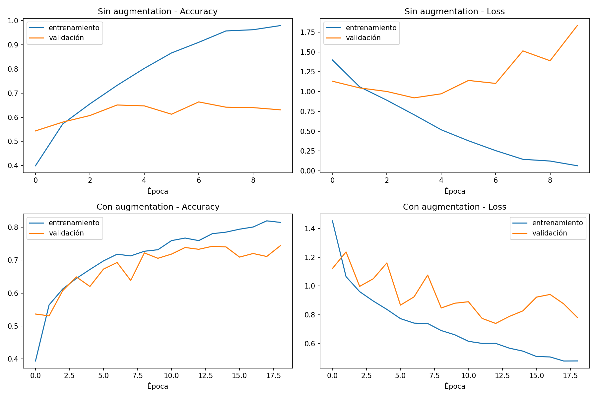
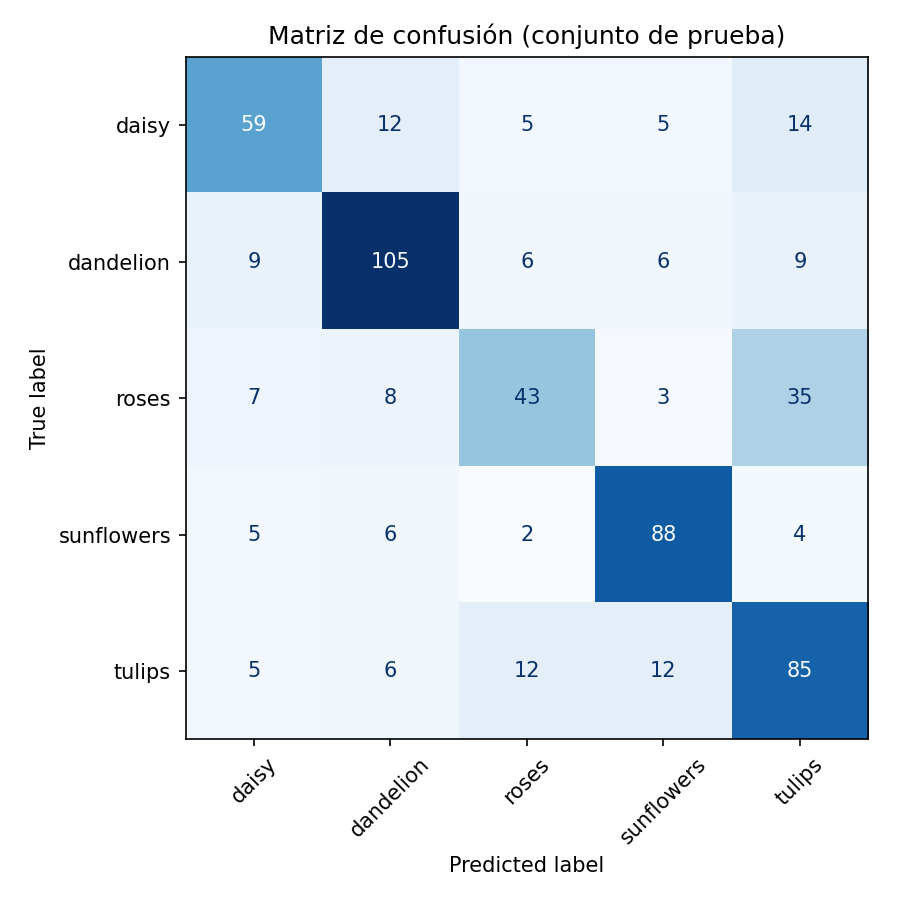
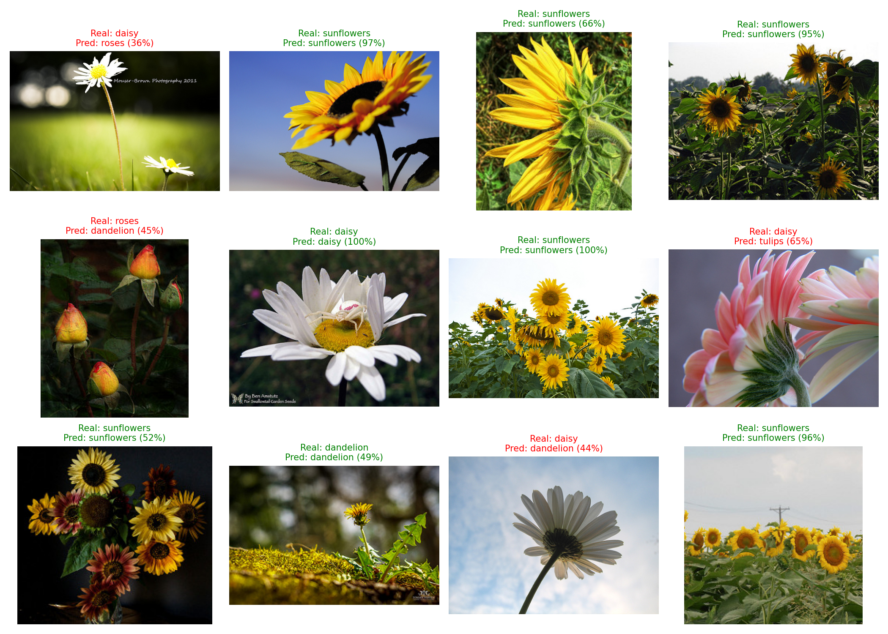

## Dataset

**Flowers Photos** (`tf_flowers`), publicado por el equipo de TensorFlow.

- ≈ 3.670 imágenes a color (JPG) de tamaño variable
- 5 clases: `daisy`, `dandelion`, `roses`, `sunflowers`, `tulips`
- Descarga automática desde `train.py` y desde el notebook (no se incluye en el repositorio por su tamaño)
- Partición estratificada: 70 % entrenamiento, 15 % validación, 15 % prueba (551 imágenes en prueba)

## Estructura del repositorio

```
proyecto-cnn/
├── notebooks/
│   └── 01_experimentacion.ipynb   
├── src/
│   ├── train.py                   
│   └── predict.py                 
├── app/
│   └── app.py                     
├── models/
│   ├── flower_cnn.keras           
│   └── class_names.json           
├── reports/figures/               
├── requirements.txt
└── README.md
```

## Instalación

Requiere **Python 3.10, 3.11 o 3.12** (TensorFlow aún no tiene versión estable para Python 3.13 o superior).

```bash
# 1. Crear y activar un entorno virtual
python -m venv .venv
.venv\Scripts\activate            # Windows
source .venv/bin/activate         # Mac / Linux

# 2. Instalar dependencias
pip install -r requirements.txt
```

## Cómo ejecutar

### Opción 1: Notebook (Google Colab)

1. Abre `notebooks/01_experimentacion.ipynb` en [Google Colab](https://colab.research.google.com).
2. Activa la GPU: *Entorno de ejecución → Cambiar tipo de entorno → T4 GPU*.
3. Ejecuta todo: *Entorno de ejecución → Ejecutar todo*.

### Opción 2: Entrenar desde la terminal

```bash
python src/train.py              # entrena (hasta 40 épocas) y guarda el modelo en models/
python src/train.py --epochs 20  # menos épocas
```

> Nota: ejecutar esto reentrena el modelo y reemplaza el de `models/`.

### Predecir una imagen desde la terminal

```bash
python src/predict.py ruta/a/mi_flor.jpg
```

### Aplicación Streamlit

```bash
streamlit run app/app.py
```

Se abre en el navegador (normalmente http://localhost:8501). Sube una imagen JPG o PNG y la app muestra la **clase predicha**, su **nivel de confianza** y la probabilidad de cada clase.

## Arquitectura de la CNN

```
Input (180x180x3)
→ Data Augmentation (flip horizontal, rotación, zoom)   [solo en entrenamiento]
→ Rescaling (÷255)
→ Conv2D(32)  → MaxPooling
→ Conv2D(64)  → MaxPooling
→ Conv2D(128) → MaxPooling
→ Dropout(0.3) → Flatten
→ Dense(128, relu)
→ Dense(5, softmax)
```

- Pérdida: `sparse_categorical_crossentropy` · Optimizador: `adam`
- `EarlyStopping` sobre `val_loss` (paciencia 6, restaura los mejores pesos)

## Resultados

### Comparación: con y sin Data Augmentation

| Modelo | Accuracy validación | Accuracy prueba | Loss prueba |
|---|---|---|---|
| Sin Data Augmentation | 66.36 % | 68.06 % | 0.8868 |
| **Con Data Augmentation (modelo final)** | **74.36 %** | **68.97 %** | **0.7643** |

### Métricas del modelo final (conjunto de prueba)

| Métrica | Valor |
|---|---|
| Accuracy | 68.97 % |
| F1 promedio (macro) | 0.68 |
| Precision promedio (macro) | 0.69 |
| Recall promedio (macro) | 0.68 |

| Clase | Precision | Recall | F1-score | Imágenes |
|---|---|---|---|---|
| daisy | 0.69 | 0.62 | 0.66 | 95 |
| dandelion | 0.77 | 0.78 | 0.77 | 135 |
| roses | 0.63 | 0.45 | 0.52 | 96 |
| sunflowers | 0.77 | 0.84 | 0.80 | 105 |
| tulips | 0.58 | 0.71 | 0.64 | 120 |

### Análisis

- **Data Augmentation:** el modelo con augmentation mejoró la accuracy de validación de 66.36 % a 74.36 % y redujo la pérdida en prueba de 0.8868 a 0.7643. Sin embargo, la accuracy en prueba solo subió de 68.06 % a 68.97 %, una diferencia pequeña, por lo que la mejora en la accuracy final no es concluyente. La accuracy de validación (74.36 %) es algo optimista frente a la de prueba (68.97 %), porque la validación se usó para elegir la mejor época del entrenamiento.
- **Mejores clases:** `sunflowers` (F1 0.80) y `dandelion` (F1 0.77) son las más fáciles de reconocer, probablemente porque tienen formas y colores muy distintivos (centro oscuro con pétalos amarillos; cabeza redonda y esponjosa).
- **Clase más difícil:** `roses` tiene el recall más bajo (0.45): el modelo no detecta más de la mitad de las rosas. Junto con la baja precisión de `tulips` (0.58), esto sugiere que varias rosas se están clasificando como tulipanes, algo que se puede ver en la matriz de confusión. Ambas flores pueden parecerse en color y forma de pétalos.
- **Conclusión:** una accuracy cercana al 69 % es razonable para una CNN entrenada desde cero con unas 2.500 imágenes de entrenamiento.

**Curvas de entrenamiento**



**Matriz de confusión**



**Predicciones de ejemplo**



## Limitaciones

- El modelo solo conoce 5 tipos de flores: si se le da otra imagen (un perro, otra flor), igual responderá con una de las 5 clases.
- Es una CNN entrenada desde cero con pocas imágenes; usar *transfer learning* (por ejemplo MobileNetV2) probablemente mejoraría la accuracy.
